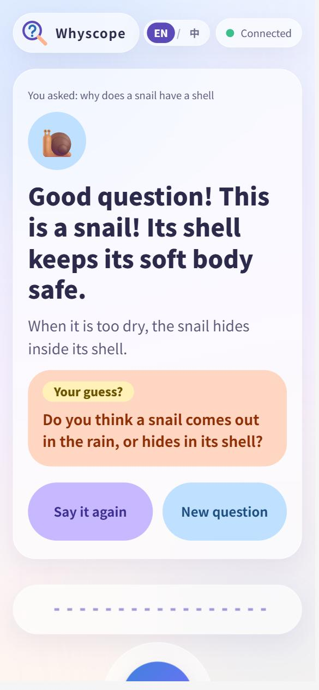
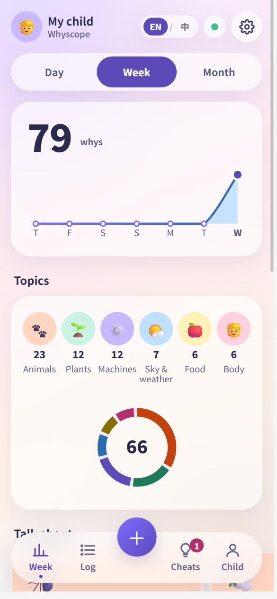
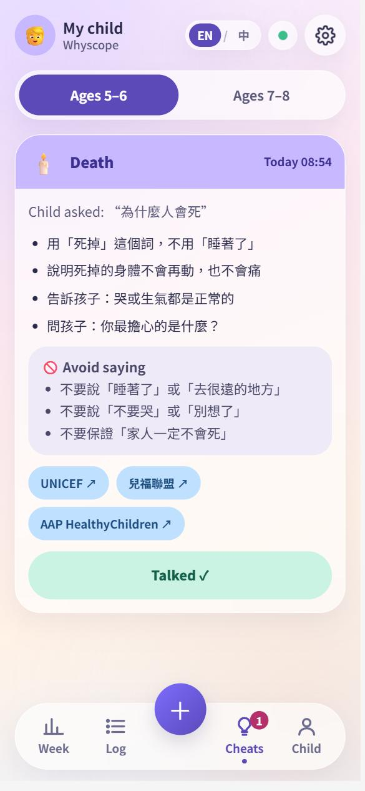

# Whyscope (好奇鏡)

**An on-device "why" answerer for children aged 5-8, by team SudoStudio (ASUS UGen AI League 2026, Stage II).** A child asks
by voice, by typing or by showing an object to the camera; the family's own computer, with an ASUS UGen300 USB (Hailo-10H) as
its ears, eyes and helper, answers in short child-level sentences from curated text. When it is not sure it says so and passes
the question to a parent, whose approved answer reaches the child later. Voice and photos stay at home and are never uploaded;
away from home the child's device reaches the hub through an end-to-end encrypted relay.

**Status: Stage II prototype. Hailo mode (UGen300) is working; kid and parent web pages are prototype clients.**

## Features

- **Ears, eyes, helper on the UGen300:** Whisper-Small English speech recognition, YOLOv8s + CLIP object recognition, and an
  LLM that drafts answers for the parent ([docs/ugen.md](docs/ugen.md)).
- **Safe answers:** knowledge entry -> family answer -> principle library -> "I'm not sure, I'll ask your grown-up"; sensitive
  topics go to a parent with talking points ([docs/safety.md](docs/safety.md)).
- **Parent in the loop:** To-answer list, LLM drafts checked by a person, approved answers kept as family answers.
- **Many children, anywhere:** households, children, parents with PIN, QR pairing; encrypted relay and an offline "curiosity
  jar" ([docs/relay.md](docs/relay.md)).
- **Private:** no cloud AI at run time; audio and images are processed in memory and not stored.
- Knowledge: 207 entries (93 curated, 114 AI drafts awaiting review) and 71 principles (AI drafts awaiting review).

## Docs

[Architecture](docs/architecture.md) | [UGen300 usage](docs/ugen.md) | [Hardware and bring-up](docs/hardware.md) |
[Relay](docs/relay.md) | [Safety](docs/safety.md) | [Business](docs/business.md) | [Roadmap and design story](docs/roadmap.md) |
[Benchmarks](docs/benchmarks.md) | [Spec](docs/spec.md) | [Models](docs/models.md) | [Slides outline](submission/slides.md) |
[Video script](submission/video_script.md)

## Models

| model | job | where it runs | source | size |
|---|---|---|---|---|
| Qwen2.5-1.5B-Instruct (HEF, Q4) | chat replies, hedged AI guesses, parent drafts, explanation rewrite (kept after an A/B against Qwen3-1.7B and Qwen3-VL-2B: fewest false guesses, fastest; [eval/model_ab_report.md](eval/model_ab_report.md), AI-judged) | UGen300 (CPU/GPU in other modes) | Qwen / hailo-ollama `qwen2.5:1.5b` | about 2.46 GB HEF |
| Qwen3-VL-2B-Instruct (HEF, optional, off by default) | names a held-up object when CLIP is not sure; replaces the text model when on | UGen300 | Qwen / Hailo model zoo | about 3.19 GB HEF |
| Whisper-Small | English speech recognition | UGen300 | OpenAI Whisper, Hailo HEF | n/a |
| YOLOv8s | find the object | UGen300 (YOLOv8n on CPU) | Ultralytics, Hailo HEF | n/a |
| CLIP ViT-B/32 image encoder | match object to a label | UGen300 (OpenCLIP on CPU) | OpenAI CLIP, Hailo HEF; text labels precomputed | n/a |
| faster-whisper small | Chinese speech recognition and fallback | CPU / GPU | Systran/faster-whisper-small | about 0.46 GB |
| paraphrase-multilingual-MiniLM-L12-v2 | question matching | CPU | sentence-transformers | n/a |
| Browser speechSynthesis | speaking | the client's browser | OS / browser | none |

Licenses and links: [docs/models.md](docs/models.md).

## Why on-device

Children's voices and living rooms should not go to a cloud. Whyscope processes audio and images in memory,
stores only question and answer text, calls no cloud AI at run time, and routes anything sensitive or uncertain to a
parent instead of guessing. See [docs/safety.md](docs/safety.md).

## Quickstart

For Hailo mode (UGen300): install the driver and HailoRT, set the `hailo:` HEF paths and `hailo.worker` in `config.yaml`, set `mode: hailo`,
start `python -m hub.hailo_worker` in the HailoRT Python, then the hub ([docs/hardware.md](docs/hardware.md)). The steps below run the CPU/GPU hub.

```powershell
powershell -ExecutionPolicy Bypass -File scripts\install.ps1   # venv + deps + models (Linux/macOS: scripts/install.sh)
scripts\run.ps1                                                  # serves http://localhost:8000  (scripts/run.sh)
# open http://localhost:8000/kid  (child)   and   http://localhost:8000/parent  (parent)
# English is the default (questions, answers, speech); add ?lang=zh for Chinese: http://localhost:8000/kid?lang=zh
```

Language: the child and parent pages start in English. The "EN / 中" toggle (or `?lang=zh`) switches the page and the
answer language and also saves the server default (`POST /api/settings {"language": "zh"}`); `POST /api/ask` takes an
optional `lang` ("en" | "zh", default = that setting). Speech recognition (faster-whisper) and the browser voice follow the
language; English answers use an en-US voice (Natural / Aria / Jenny / Samantha / Google US English first).

Add `-Cpu` / `--cpu` to the installer on machines without an NVIDIA GPU and set `mode: cpu` in `config.yaml`.
Optional extras (vision, LLM compose) are in `requirements-optional.txt`; the hub works without them
(object from text, explanation from the entry's first fact).

If the checkout path is very long (over about 140 characters), the Windows installer puts the venv at
`C:\whyscope-venv` instead of `.venv` (CUDA DLLs fail to load from deep paths) and records it in `.venvpath`;
the run script follows that file.

## Screenshots

Taken in the built-in browser at 390 x 844 (phone portrait) with demo data (`scripts/seed_demo.py`: 29 real
questions, back-dated over two weeks; the child is called 小安 only on the parent page).

English is the default (`?lang=en`); the pill toggle "EN / 中" in each header switches to Chinese and is remembered in `localStorage.whyscope_lang`. In English mode the questions, answers, talk-about lines and cheat-sheet talking points are English too.

| Child: answer | Parent: Week | Parent: Cheats |
|---|---|---|
|  |  |  |

## How an answer is spoken (product pass 1)

`POST /api/ask` returns after safety and recall (about 10 ms for text, about 330 ms for voice including ASR) with the
verbatim first sentence, `pending: true` and a `pending_id`; the explanation and the question back are composed in the
background and fetched with `GET /api/ask/{pending_id}` (HTTP 202 until ready; `?wait=1` on the POST gives the old
single-response behaviour). `kid.html` speaks the first sentence at once, polls every 300 ms (up to 8 s) and then speaks
the rest, sentence by sentence, with the sentence being spoken highlighted.

The voice rules live in `hub/wording.py` and are enforced in code: at most 18 characters per sentence, one explanation
sentence for ages 5-6 and two for 7-8, first sentence plus explanation at most 60 characters, no science jargon
(replaced by plain phrases), at most 2 uncommon characters per sentence, no device feelings or flattery, and every
question back is guessable (嗎 / 還是 / 猜 / 你覺得) and never asks about the child's day, feelings, family or friends.
Any LLM output that breaks a rule, repeats the first sentence or adds knowledge that is not in the entry is replaced by a
deterministic rewrite of the entry's own facts. Check it yourself with the server running:
`python eval/check_answers.py --age 6` (and `--age 8`).

English mode has its own rules in the same file: at most 12 words per sentence, at most 2 explanation sentences (1 for
ages 5-6), at most 45 spoken words, a plain-phrase map for about 15 science terms (reflect -> bounce back, ...), and at
most 2 uncommon words per sentence (a word longer than 9 letters counts double). "Common words" are a frozen list, not
built from whatever entries exist: `hub/data/common_words_en_baseline.txt` (words of the REVIEWED entries, AI drafts excluded, plus the plain
phrases; rebuilt with `scripts/build_common_chars.py`) plus a small early-reader list (`common_words_en_basic.txt`). The name of the
thing asked about (the entry's own labels) is never counted as uncommon. Same idea for Chinese characters (`common_chars.txt`).
`python eval/check_voice.py` checks every entry, draft or not, against these lists. The question back must contain "?" and one of "do you think", "or", "guess", "can you", "is it", "does".
Check: `python eval/check_answers.py --lang en --age 6` and `python eval/run_abstention.py --lang en`.

## The reply turn (2026-11-14)

The question back is no longer the end of the conversation. Under it the kid page shows two answers and "我不知道 /
I don't know"; the child taps one, or holds the round button and says it. `POST /api/reply {event_id, choice | text,
lang}` (or multipart with `audio`) answers once more:

| child's answer | Whyscope says (spider entry) |
|---|---|
| the right one (八隻) | 對！蜘蛛有八隻腳，不是昆蟲。 |
| the other one (六隻) | 其實是「八隻」喔。蜘蛛有八隻腳，不是昆蟲。 |
| 我不知道, or a spoken answer that matches neither | 答案是「八隻」。蜘蛛有八隻腳，不是昆蟲。 |

- **Deterministic and instant.** `knowledge/quiz.json` holds the two options, the right one (or "both", or none for
  questions without a single answer) and which entry fact reveals it, for all 93 entries in both languages. No LLM is
  involved, so the reply cannot invent knowledge and costs nothing on the UGen300. 24 Chinese and 17 English keys have
  no fact that states the answer and use a short `reveal` sentence instead (written with the key, not taken from the
  entry's source); 3 Chinese and 9 English questions have no single right answer. The file is marked
  `reviewed_by: ""` until a person checks it. `python eval/check_quiz.py` checks every key (indices, wording rules, voice matching).
- **The explanation no longer gives the answer away.** The revealing fact is left out of the explanation (LLM and
  template), so the child guesses first and hears it after.
- **Never "wrong".** A wrong guess gets the answer and the fact, not a verdict; no praise either (the voice rules).
- **A spoken reply that is really a new question** ("為什麼…", "why…") is asked as a new question.
- Bridge questions (about the child's own home) have no quiz and stay open as before. The reply and how it went are
  stored on the event (`reply`, `reply_result`) for the parent page.

## Answer order, principle library, parent assistant

Chit-chat ("hi", "you're silly", "I'm sad", "what is this?") gets a short guarded chat reply from the UGen300 LLM. A question
is answered by the first of: (1) a knowledge-base entry (in English the question must also name the entry's object,
so near-misses such as "Why do things fall down?" -> rain no longer match), (2) a family answer a parent approved earlier,
(3) a principle from the library, (4) a hedged one-sentence AI guess ("I think ..."), shown as a guess and put on the parent's
To answer list (setting `ai_guess`, default on), (5) otherwise it is passed to a parent. Details:
[docs/architecture.md](docs/architecture.md); measurements in [eval/chat_report.md](eval/chat_report.md).

- **Principle library** (`knowledge/principles/principles.json`, about 70 principles, an AI draft that no person has reviewed).
  Principles are found by embedding with a score floor and a margin and answered with a pre-written sentence, never with
  LLM-written text; `{object}` is filled only when the asked thing is one the principle lists. Config `principles.enabled`
  (default true), `principles.floor`, `principles.margin`. Principle answers are marked `draft` on the event (`source`
  `principle:<id>`) and in the parent page's event view. Science questions about earthquakes and the like are answered; scary-news
  style questions still go to a parent.
- **Parent assistant.** Abstained questions appear in the parent page's **To answer** list (one row per question). While no child
  is asking (20 s idle), the UGen300 writes a draft for each: 3 short sentences plus a "Try it together" activity, grounded in the
  3 best-matching principles or entries, checked against the wording rules, never shown to the child. The parent approves, edits
  or dismisses; an approved answer is stored as a **family answer** (asked again, the child gets it) and delivered to the kid
  page: "Your grown-up found the answer!" then the answer is spoken. Drafts are weak when the facts do not fit the question, so
  they are labelled "Draft written by the device. Check it before your child hears it." Config `assistant.enabled`, `idle_s`,
  `family.threshold`. API: `/api/todo`, `/api/todo/{id}/approve|dismiss|redraft`, `/api/family`, `/api/deliveries`.

## Architecture in brief

`listen -> safety -> vision -> recall -> compose -> log`. The first sentence always comes verbatim from the
knowledge entry; a small LLM may only rewrite the entry's facts, with a grounding check and a template fallback.
On a UGen300 (`mode: hailo`) one worker process owns the device and serves the LLM, Whisper (English), YOLO and the CLIP
image encoder to the hub over localhost; if it is down the hub falls back to faster-whisper and template answers.
Details, the modes table and data-flow diagram: [docs/architecture.md](docs/architecture.md).
The binding contract is [docs/spec.md](docs/spec.md).

## Repo map

```
hub/            FastAPI service + hailo_worker.py (UGen300 device manager) (server, pipeline, listen, safety, vision, recall, principles, family, assistant, compose, wording, emoji, memory, report, db)
hub/static/     kid.html (child) and parent.html (parent), single-file pages, no CDNs
knowledge/      entries/<topic>/*.json (CC BY-SA 4.0), cheats/*.json, sensitive_rules.json
eval/           run_latency.py, run_abstention.py, check_answers.py, abstention_set.jsonl, abstention_set_en.jsonl
scripts/        install and run scripts, download_models.py, build_common_chars.py, seed_demo.py
docs/           spec, architecture, ugen, hardware, relay, safety, business, roadmap, models, benchmarks
submission/     slides.md (deck outline), video_script.md
relay/          encrypted relay (Cloudflare Worker + Durable Object, or Node)
config.yaml     mode (cpu | gpu | hailo), models, thresholds, retention
```

## Measure it

```
.venv\Scripts\python eval\run_latency.py        # per-stage mean / p95, appends to docs/benchmarks.md
.venv\Scripts\python eval\run_abstention.py     # answer/abstain accuracy on eval/abstention_set.jsonl
.venv\Scripts\python eval\run_latency.py --url http://127.0.0.1:8000   # same, through a running server (adds http_first_ms)
.venv\Scripts\python eval\check_answers.py --age 6   # child-voice rules on 10 real answers (server running)
.venv\Scripts\python eval\check_answers.py --lang en   # the same in English (eval/abstention_set_en.jsonl)
.venv\Scripts\python eval\run_abstention.py --lang en   # English answer/abstain accuracy
```

## License

Code: Apache-2.0 (`LICENSE`). Knowledge entries: CC BY-SA 4.0 (`knowledge/LICENSE`). Models keep their own
licenses, listed in [docs/models.md](docs/models.md).

## Accounts, pairing and the relay (2026-11-15)

No more open LAN: every call carries a device token. First run: open `http://127.0.0.1:8000/setup` on the hub computer, create the
household and the first parent (name + PIN) and scan the QR code with the parent's phone. On the parent page (Settings > Family) add
children, "Add a wand for <child>" and "Invite another parent" (each a QR code), and revoke devices. Wands see only their own child;
the PIN is asked again for export / clear, revoke, settings and adding devices. A wand that cannot reach the hub keeps questions in
its curiosity jar. `auth.allow_localhost_dev` (config.yaml, default `true`) lets token-less calls from the hub machine act as the first
household's parent, so eval scripts keep working: set it to `false` for a real deployment. Details: docs/architecture.md, docs/relay.md.
