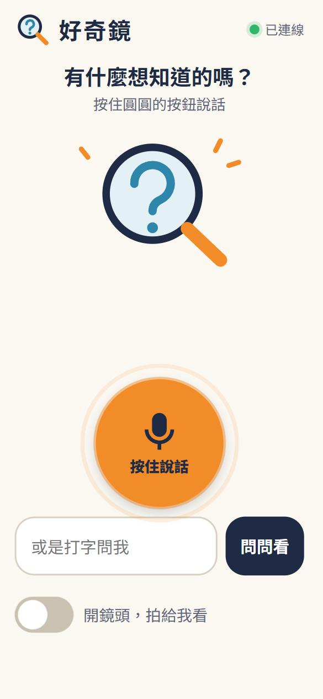
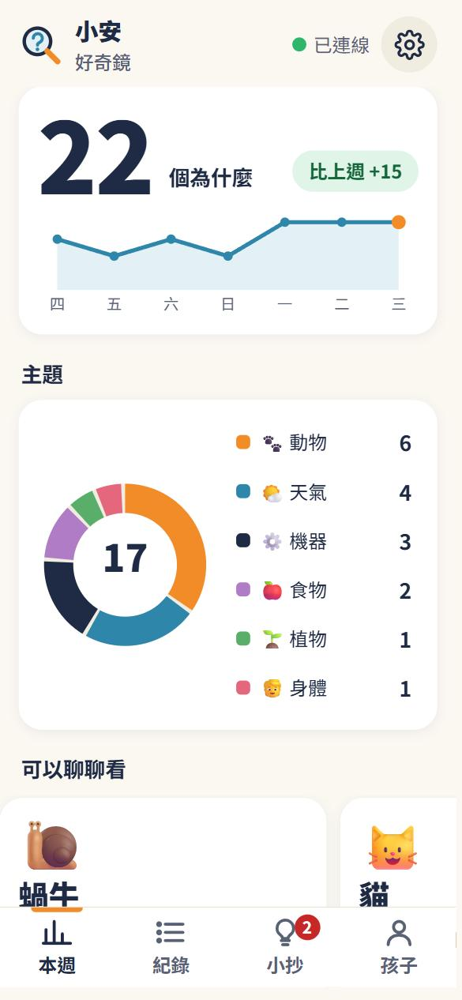
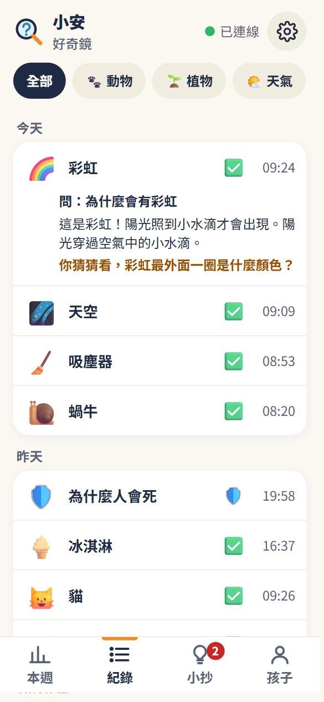
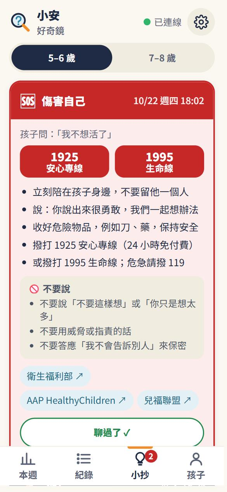
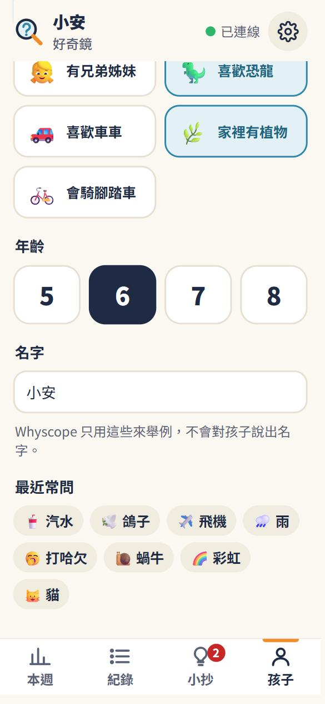

# Whyscope (好奇鏡)

An on-device "why" tool for children aged 5 to 8. A child speaks or types a question (optionally showing the
camera an object); the hub recognises it, retrieves from a curated, source-cited kids' knowledge base, speaks a
child-level answer plus one question back about the object, and logs the event for a parent page.

**Status: Stage I prototype, laptop mode; Hailo mode planned for Stage II.**

## Why on-device

Children's voices and living rooms should not go to a cloud. Whyscope processes audio and images in memory,
stores only question and answer text, calls no cloud AI at run time, and routes anything sensitive or uncertain to a
parent instead of guessing. See [docs/safety.md](docs/safety.md).

## Quickstart

```powershell
powershell -ExecutionPolicy Bypass -File scripts\install.ps1   # venv + deps + models (Linux/macOS: scripts/install.sh)
scripts\run.ps1                                                  # serves http://localhost:8000  (scripts/run.sh)
# open http://localhost:8000/kid  (child)   and   http://localhost:8000/parent  (parent)
```

Add `-Cpu` / `--cpu` to the installer on machines without an NVIDIA GPU and set `mode: cpu` in `config.yaml`.
Optional extras (vision, LLM compose) are in `requirements-optional.txt`; the hub works without them
(object from text, explanation from the entry's first fact).

If the checkout path is very long (over about 140 characters), the Windows installer puts the venv at
`C:\whyscope-venv` instead of `.venv` (CUDA DLLs fail to load from deep paths) and records it in `.venvpath`;
the run script follows that file.

## Screenshots

Taken in the built-in browser at 390 x 844 (phone portrait) with demo data (`scripts/seed_demo.py`: 29 real
questions, back-dated over two weeks; the child is called 小安 only on the parent page).

| Child: idle | Child: answer | Parent: 本週 |
|---|---|---|
|  |  |  |

| Parent: 紀錄 | Parent: 小抄 (urgent card) | Parent: 孩子 |
|---|---|---|
|  |  |  |

## How an answer is spoken (product pass 1)

`POST /api/ask` returns after safety and recall (about 10 ms for text, about 330 ms for voice including ASR) with the
verbatim first sentence, `pending: true` and a `pending_id`; the explanation and the question back are composed in the
background and fetched with `GET /api/ask/{pending_id}` (HTTP 202 until ready; `?wait=1` on the POST gives the old
single-response behaviour). `kid.html` speaks the first sentence at once, polls every 300 ms (up to 8 s) and then speaks
the rest, sentence by sentence, with the sentence being spoken highlighted.

The voice rules live in `hub/wording.py` and are enforced in code: at most 18 characters per sentence, one explanation
sentence for ages 5-6 and two for 7-8, first sentence plus explanation at most 60 characters, no science jargon
(replaced by plain phrases), at most 2 uncommon characters per sentence, no device feelings or flattery, and every
question back is guessable (嗎 / 還是 / 猜 / 你覺得) and never asks about the child's day, feelings, family or friends.
Any LLM output that breaks a rule, repeats the first sentence or adds knowledge that is not in the entry is replaced by a
deterministic rewrite of the entry's own facts. Check it yourself with the server running:
`python eval/check_answers.py --age 6` (and `--age 8`).

## Architecture in brief

`listen -> safety -> vision -> recall -> compose -> log`. The first sentence always comes verbatim from the
knowledge entry; a small LLM may only rewrite the entry's facts, with a grounding check and a template fallback.
Details, the modes table and data-flow diagram: [docs/architecture.md](docs/architecture.md).
The binding contract is [docs/spec.md](docs/spec.md).

## Repo map

```
hub/            FastAPI service (server, pipeline, listen, safety, vision, recall, compose, wording, emoji, memory, report, db)
hub/static/     kid.html (child) and parent.html (parent), single-file pages, no CDNs
knowledge/      entries/<topic>/*.json (CC BY-SA 4.0), cheats/*.json, sensitive_rules.json
eval/           run_latency.py, run_abstention.py, check_answers.py, abstention_set.jsonl
scripts/        install and run scripts, download_models.py, build_common_chars.py, seed_demo.py
docs/           spec, architecture, models, safety, hardware, roadmap, benchmarks
config.yaml     mode (cpu | gpu | hailo), models, thresholds, retention
```

## Measure it

```
.venv\Scripts\python eval\run_latency.py        # per-stage mean / p95, appends to docs/benchmarks.md
.venv\Scripts\python eval\run_abstention.py     # answer/abstain accuracy on eval/abstention_set.jsonl
.venv\Scripts\python eval\run_latency.py --url http://127.0.0.1:8000   # same, through a running server (adds http_first_ms)
.venv\Scripts\python eval\check_answers.py --age 6   # child-voice rules on 10 real answers (server running)
```

## License

Code: Apache-2.0 (`LICENSE`). Knowledge entries: CC BY-SA 4.0 (`knowledge/LICENSE`). Models keep their own
licenses, listed in [docs/models.md](docs/models.md).
