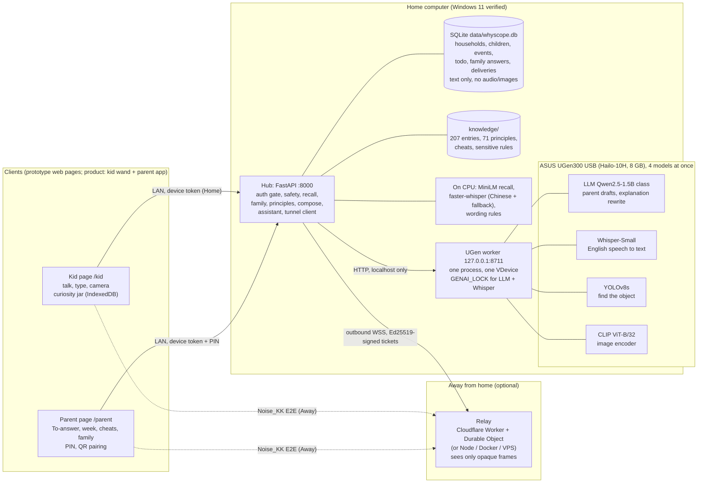

# Architecture

Whyscope (好奇鏡) answers young children's "why" questions on a computer in the family's home. One **hub** (FastAPI, `hub/`)
runs the pipeline; one **worker** (`hub/hailo_worker.py`) owns the ASUS UGen300 USB (Hailo-10H) and serves four models on one
shared device; kid and parent web pages are the prototype clients; an optional end-to-end encrypted **relay** lets them reach
the hub away from home. Voice and photos are processed at home and never uploaded. The binding contract is
[spec.md](spec.md); what runs on the UGen300 and why is in [ugen.md](ugen.md).

## System diagram



Solid lines are the home path; dotted lines are the away path (the hub dials OUT to the relay, so the router needs no port
forwarding). If the worker is down the hub falls back to CPU models and template answers, and recovers when the worker is
restarted.

## Answer order (summary)

Safety first (sensitive topics go to a parent), then an **intent** step (`hub/intent.py`, cheap rules): chit-chat, feelings,
teasing, jokes, commands, statements and "what is this?" go to a **chat reply**; real questions go on to: **knowledge-base
entry** (embedding score, label guard and asks guard) -> **family answer** (a parent approved it earlier) -> in English only, the
**answer bank** (5,090 fact-checked short answers; it also goes before a weaker KB match, see "Answer order") -> **principle library**
(keyword and coverage gates) -> **AI guess** (a hedged one-sentence guess from the UGen300 LLM, "I think ...", marked as a guess
on the child's screen, logged as a draft and put on the parent's **To answer** list prefilled with the guess) -> **abstain**
("I'm not sure, I'll ask your grown-up") when guessing is off, fails, or the guard rejects it. Chat replies and guesses are
LLM text: every one passes `hub/guard.py` (safety rules on the output, block list, length, plain words, English only, no numbers
or names in a guess) or is replaced by a canned line. Details: "Chat and AI guess" below and `eval/chat_report.md`.

## Data flow

```
 CHILD CLIENT  /kid                          HUB (FastAPI, hub/)                              PARENT  /parent
 ┌──────────────────────┐   POST /api/ask   ┌────────────────────────────────────────┐
 │ hold-to-talk (audio) │ ───────────────►  │ 1 listen   faster-whisper  audio→text  │
 │ or typed text        │   multipart       │ 2 safety   keyword rules → sensitive?  │──► event(sensitive) ─┐
 │ optional camera frame│                   │ 3 vision   YOLO+CLIP (optional)        │                      │
 │                      │                   │ 4 recall   MiniLM cosine vs KB index   │                      │
 │ shows + speaks:      │ ◄───────────────  │            score < threshold → abstain │──► event(abstained)  │
 │  first_sentence      │   JSON answer     │ 5 compose  Qwen2.5-1.5B rewrite of     │                      │
 │  explanation         │                   │            facts, grounded, 6 s cap,   │                      │
 │  ask_back            │                   │            else template fallback      │                      │
 │ (browser TTS, zh-TW) │                   │ 6 log      SQLite event (no media)     │──► event(answered) ──┤
 └──────────────────────┘                   └────────────────────────────────────────┘                      │
                                                    ▲ knowledge/entries/*/*.json (CC BY-SA 4.0)             ▼
                                                    │ knowledge/cheats/*.json, sensitive_rules.json    本週 · 問題紀錄 · 家長小抄
                                                    │                                                  孩子的世界 · 設定
                                                    └── memory (parent facts → "bridges" to the child's world)
```

Key rules (spec section 8):

- The **first sentence is always the knowledge entry's own sentence**, spoken verbatim. The LLM never writes it,
  and nothing waits for the LLM before it can be spoken (`latency_ms.first_sentence` measures this).
- The LLM may only rewrite the entry's `facts` into one or two short sentences. A jieba grounding check
  requires every sentence to share a content word with a fact; otherwise, or on timeout or error,
  `explanation = facts[0]` and `ask_back = entry.ask_back`.
- Bridges (e.g. `has_dog`) are KB sentences, inserted verbatim only when the parent has set the matching memory key.
- Audio and image bytes live in memory for the duration of one request and are never written to disk or to SQLite.

## Answer order

For every question that is not sensitive and not chit-chat, `hub/pipeline.py` tries five things in this order and stops at the first:

1. **Knowledge-base entry** (`hub/recall.py`): embedding score at least `recall.threshold`. In English the question must also
   *name the entry's object*: a word of the entry's labels, its id, or a distinctive word of its question patterns (one that at
   most `recall.label_key_df` entries use). Without that overlap the entry needs `recall.no_label_threshold` (0.85) instead of
   0.55, so "Why do things fall down?" no longer lands on the rain entry and "Why is it dark at night?" no longer lands on
   cat eyes. The first sentence is the entry's own, the explanation is composed as before.
2. **Family answer** (`hub/family.py`): an answer a parent approved from the "To answer" list, for a near-duplicate question
   (cosine at least `family.threshold` 0.88, and most content words shared).
   **Answer bank** (English questions only, `hub/bank.py`, `knowledge/answer_bank_en.jsonl`, a copy of the frozen
   `eval/answer_bank/bank_en_v2.jsonl`): the item whose question or child-style variants are closest (max cosine, same MiniLM
   model) at or above `answer_bank.threshold` (0.80; `eval/answer_bank/report_v2.md`). A KB entry keeps priority when its match
   is strong (score at least `answer_bank.kb_strong` 0.85, or a near-verbatim example question, plain cosine at least
   `recall.verbatim_score` 0.93); a weaker KB match loses to the bank only when the bank item's score is at least
   `answer_bank.kb_margin` (0.05) above the entry's plain cosine, and a family answer still comes first. The child hears `a1`
   verbatim with the item's `ask_back` (dropped if it asks about the child's day, feelings, family or friends, except on items
   marked sensitive, which keep their gentle wording and grown-up ask-back); "why?" / "tell me more" gives `a2`. Source
   `bank:<id>`, not a draft, never on the To-answer list. Embeddings are cached in `data/answer_bank_en.npz` (keyed by the bank
   file's sha256 and the model name). Before / after on 145 held-out questions: `eval/run_bank_order.py`.
3. **Principle** (`hub/principles.py`): see below.
4. **AI guess** (`hub/chat.py`, household setting `ai_guess`, default on): a hedged one-sentence guess, grounded by the nearest
   entries / principles when they score at least `chat.context_floor`; source `ai_guess`, `draft`, and a to-answer item whose
   draft is the guess (approve keeps it as a family answer without re-delivering it; edit corrects it).
5. **Abstain**: "ask a grown-up", the event is logged and becomes a to-answer item for the parent.

### Chat and AI guess

- `hub/intent.py` classifies before recall: `question`, `rule` ("Why do I have to go to bed?"), `deictic` ("What is this?"),
  `followup` ("why?", "tell me more" within `chat.memory_s` of the last turn) and `chat` (sub-kinds greeting, thanks, bye, tease,
  feeling_*, silly, joke, command, about_me, statement, unclear). Sensitive text never reaches chat or guess.
- `hub/chat.py` writes the reply on the UGen300 LLM (worker `/complete`, fixed primed prefix per mode and language); jokes and
  unclear input get canned lines. The child's request has priority over the parent assistant's drafting (the worker breaks a
  draft at the next token). A reply that times out (`chat.timeout_s`), fails or fails the guard becomes a canned line; the
  reason is in the event's `llm` column.
- A short per-child memory (`chat.memory_turns` turns, `chat.memory_s` seconds) lets "why?" / "tell me more" continue: after
  an entry it says the next fact of that entry; after an answer-bank item, its `a2`; after a sensitive turn it stays deflected.
- Camera: "What is this?" names the object when CLIP is confident (`vision.min_confidence`, `vision.clip_margin`), otherwise the
  chat reply asks the child what it is. `Vision.describe()` is the hook for a future on-device VLM (not on disk yet).

Every event records its `source` (`entry:<id>`, `bank:<id>`, `family:<id>`, `principle:<id>`, `chat`, `ai_guess`, `abstain`, `sensitive`), and `draft` / `partial`
flags (`draft` also for answers from an entry marked `"draft": "ai"`, shown as such on the parent page). Body science such as "Why is blood red?" is
answered (`science_words_en` of violence_war); injuries, fights, war and personal cues still go to the parent. Natural-event science questions ("Why do earthquakes happen?") are no longer treated as scary
news: a category may list `science_words` in `knowledge/sensitive_rules.json`, and `hub/safety.py` lets a hit that comes only
from those words pass when the question is a plain why / how / what question with no fear, news, danger, death or personal cue.
"Will an earthquake kill us?" and "The news said there was an earthquake" still go to the parent.

## Principle library

About 70 child-level science principles (`knowledge/principles/principles.json`, an AI draft: `reviewed_by` is empty, so every
answer from it is marked `draft` and shown as such on the parent page). The small on-device LLM must not write explanations for
children (`eval/principles/report.md`), so a principle answer is **retrieved, not generated**:

- Index (same MiniLM model as `recall`): per principle one row for its name, one per question example, one for its
  `applies_to` list. Score = best cosine (plus 0.05 when the asked thing is on the `applies_to` list). It answers only when the
  best score is at least `principles.floor` (0.60) and ahead of the runner-up by `principles.margin` (0.05).
- The answer is one of the principle's own pre-written `answers_en` / `answers_zh`, spoken as the first sentence, with no LLM
  rewrite and no question back. `{object}` is filled only when the asked thing (named in the question, or the label the camera
  saw) is on the `applies_to` list; otherwise a slotless answer is used. `partial: true` principles still answer, the event is
  marked partial.
- Vision: the CLIP label table also holds the `applies_to_en` phrases (`principle:<id>` rows). When the best label of all is such
  a phrase, it comes back as the object name, so a photo of an ice cube plus "why does it float?" reaches the buoyancy principle.
- Config: `principles.enabled` (default true), `floor`, `margin`.

## Parent assistant

The UGen300 as the parent's helper (`hub/assistant.py`, tables `todo`, `family_answers`, `deliveries` in `hub/db.py`):

1. An abstained question that is not sensitive and not gibberish becomes a **to-answer item**. The same question asked again
   raises the item's `count` instead of adding a row.
2. When no child request has arrived for `assistant.idle_s` (20 s), a background thread drafts the open items one by one on the
   worker LLM: at most 3 short sentences plus one "Try it together" activity, grounded in the facts of the 3 best-matching
   principles / entries (those and their scores are stored and shown; a source below 0.6 is shown but not given to the model, and
   with nothing relevant the model is told "none found"). `hub/wording.py` checks the draft and a word-novelty check flags
   sentences that bring words the facts lack; failures are marked, not hidden. A draft is **never** sent to a child.
3. **Child priority**: the draft is written one sentence per worker call (about 4 s each), the thread checks for a child request
   between sentences, stops, keeps the partial draft and resumes later. The worker serializes GenAI calls, so a child request
   waits at most for the sentence in flight. Only `mode: hailo` drafts; other modes still list the items for a typed answer.
4. The parent page's **To answer** section shows the question, the draft ("Draft written by the device. Check it before your
   child hears it."), the context used, and Approve / Edit / Dismiss. Approve or Edit + Save stores a **family answer** (question,
   answer, embedding, source event, approved time) and queues a **delivery**; the kid page polls `GET /api/deliveries`, says
   "Your grown-up found the answer!", speaks the answer (existing speech code) and marks it done.

Endpoints: `GET /api/todo`, `POST /api/todo/{id}/approve` (optional `{"answer"}`), `.../dismiss`, `.../redraft`,
`GET /api/family`, `DELETE /api/family/{id}`, `GET /api/deliveries`, `POST /api/deliveries/{id}/done`. `/healthz` reports
`principles`, `family_answers` and `assistant`. The DB migration is additive (new `events` columns, three new tables) and runs at
start-up on an existing `data/whyscope.db`.

## Components

| module | job |
|---|---|
| `hub/server.py` | HTTP API, static pages, startup (model preload, retention purge) |
| `hub/pipeline.py` | orchestration and per-stage timing |
| `hub/listen.py` | faster-whisper ASR, decoded in memory (PyAV), Traditional-script output |
| `hub/safety.py` | rules from `sensitive_rules.json` + cheat triggers, plus an always-on floor |
| `hub/vision.py` | optional YOLO crop + CLIP zero-shot over KB labels; no-op if packages are missing |
| `hub/recall.py` | sentence-transformers index over `labels + question_patterns`, cosine, threshold, label guard (en) |
| `hub/principles.py` | principle library: retrieval by embedding, pre-written answers, `{object}` slot |
| `hub/family.py` | answers a parent approved, matched by near-duplicate question |
| `hub/assistant.py` | to-answer items, background drafting on the UGen, approve / dismiss |
| `hub/compose.py` | LLM rewrite with grounding check and template fallback |
| `hub/memory.py`, `hub/db.py`, `hub/report.py` | parent facts, SQLite, weekly aggregation |

## Modes (config.yaml `mode`, spec section 9)

| stage   | cpu (any laptop)            | gpu (RTX 4060 laptop, **current default**) | hailo (Windows 11 verified, Ubuntu untested; + UGen300 USB) |
|---------|-----------------------------|---------------------------------------------|----------------------------------|
| listen  | faster-whisper small, int8  | faster-whisper small, float16               | per language (`listen.backend_by_lang`): English Whisper-Small HEF on Hailo, Chinese faster-whisper; faster-whisper also answers when the UGen fails |
| vision  | yolov8n + open_clip ViT-B-32 | same, on CUDA                              | yolov8s + CLIP image-encoder HEF on Hailo (`vision.backend: hailo`); CLIP text side is precomputed (`vision.clip_labels`), no text encoder at run time |
| recall  | MiniLM-L12 multilingual     | same                                        | same (CPU)                       |
| compose | Qwen2.5-1.5B Q4_K_M via llama-cpp-python (GGUF if present, else transformers fp32) | transformers fp16 on CUDA      | Qwen2.5-1.5B-Instruct HEF via Hailo GenAI (`hub/hailo.py`) |
| speak   | browser SpeechSynthesis zh-TW | same                                      | browser SpeechSynthesis on the phone |

In `mode: hailo`, compose, English listen and vision run on the UGen300. One process (`hub.hailo_worker`) owns the
device and the hub talks to it over localhost (`hub/hailo.py`); see [hardware.md](hardware.md) step 9.

## Network and browser notes

The hub binds to `0.0.0.0:8000`. Browsers only allow microphone and camera on `localhost` or HTTPS, so open
`http://localhost:8000/kid` on the hub machine itself; for another device on the LAN put the hub behind HTTPS
(for example a self-signed certificate on a reverse proxy) or use the typed-question box, which works over plain HTTP.

## Accounts and pairing

**Data model** (`hub/db.py`, additive migration, `user_version` 2): `households`; `children` (household, name, age, avatar; the
bridges and auto topics are per child in `child_memory`); `parents` (household, name, PIN as a salted scrypt hash); `devices`
(household, kind `wand|parent`, `child_id` for a wand, `parent_id`, name, SHA-256 of the token, created, last_seen, revoked,
`tunnel_id`); `pairing_codes` (hashed one-time codes, 10 minutes); `household_settings`. `events`, `todo` and `deliveries` carry
`child_id`; `family_answers` carry `household_id` (shared by the household's children). An old database becomes household 1 /
child 1 (the old `memory` and `settings` tables stay, unread). One hub can host several households; every query is scoped to
the caller's household, and another household's ids answer 404.

**Auth** (`hub/auth.py`, enforced by one gate in `hub/server.py`, deny by default). Every `/api` call and `/healthz` carries
`Authorization: Bearer <device token>`. A **wand** may only ask / poll / reply / read and finish its own child's deliveries,
`/api/ping`, `/api/me` and `/healthz`; everything else is 403. A **parent** device sees its household (`?child=<id>` picks the
child, default the first). The parent's **PIN** (`X-Whyscope-Pin`) is required again for data export and clear, revoking a
device, settings other than the display language, and creating a wand or parent pairing code; approving answers needs none.
Five wrong PINs lock that parent for a minute. Without a token a call is refused, except on the hub machine itself (loopback,
not via the relay, no cross-site `Origin`) while `auth.allow_localhost_dev` in config.yaml is true (**default true**, so the eval
scripts keep working; they act as household 1's parent and first child; set it to `false` for a real deployment). Relay calls are
marked by `hub/tunnel.py` (`x-whyscope-via`), so they never count as localhost, and a token reached through the relay must belong
to the relay device it was paired with. Revoking a device also revokes its relay key.

**Pairing.** First run: open `http://127.0.0.1:8000/setup` on the hub machine (localhost only): household, first parent (name +
PIN), then a QR code. (A household without a parent, such as the one made from an old database, is adopted, keeping its history.)
On the parent page, Settings > Family: add a child, "Add a wand for <child>", "Invite another parent" (each a QR code), the
device list with revoke. The QR carries `<hub LAN URL>/pair#c=<one-time code>&h=<LAN URL>&b=<relay pairing bundle>` (`auth.lan_url`
overrides the detected address; the bundle comes from `hub/tunnel.py` and is left out when no relay is set). The scanning device
opens `/pair`, trades the code for its token once (`POST /api/pair`) and stores token, hub URL and bundle in localStorage. QR
codes are drawn locally by `hub/static/qr.js` (about 250 lines, byte mode, ECC L/M, versions 1-40; checked by decoding its output
with OpenCV), no library or CDN.

**Connection modes** (`hub/static/conn.js`). Each page calls the hub DIRECT at the stored LAN address when a ping answers within
about 300 ms (badge **Home**), otherwise through the encrypted relay with `tunnelFetch` (**Away (encrypted)**), otherwise
**Offline**. An offline wand keeps the question (text, or up to 400 KB of audio) in the **curiosity jar** (IndexedDB) and sends it
when the hub is reachable again with `asked_at`, so the answer is logged and shown on the parent page with the original time.
The relay path needs a secure context (https or localhost) because the browser Noise code uses WebCrypto X25519; a page opened from
`http://<LAN ip>` works at home only. Photos and the data export are fetched with the token and shown from blob URLs.
